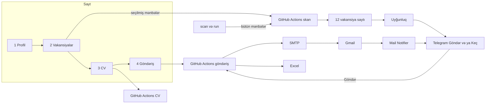
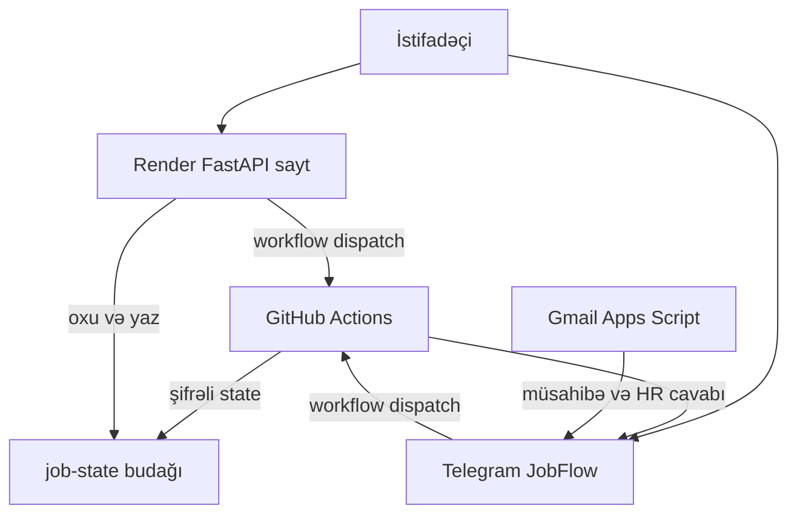
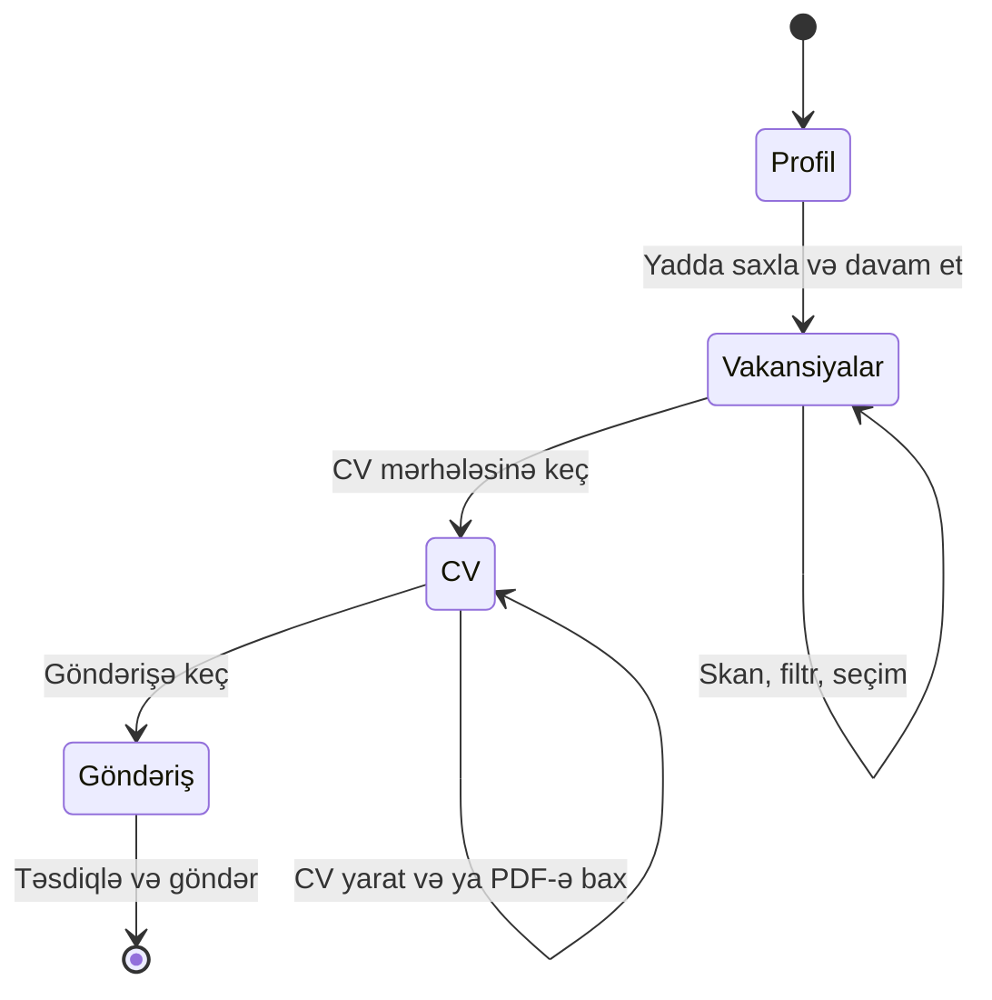
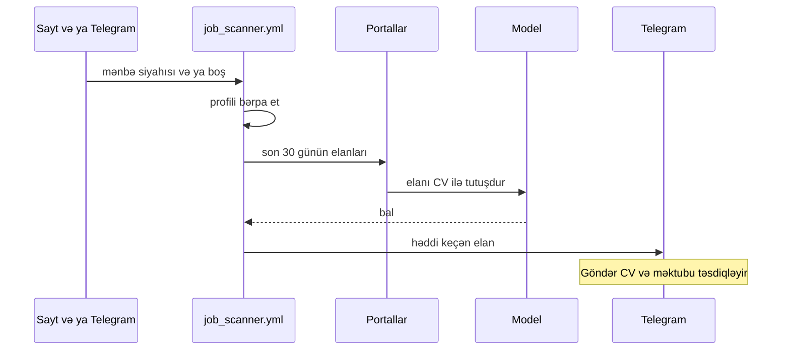
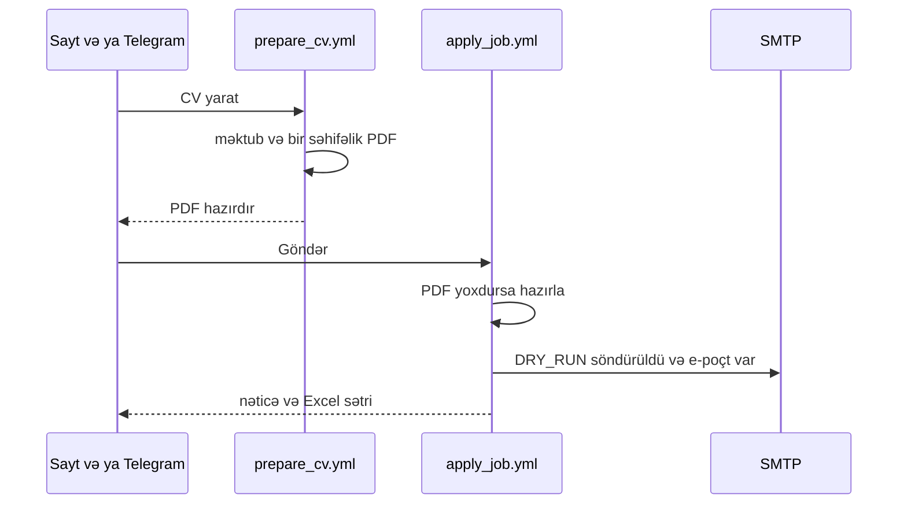
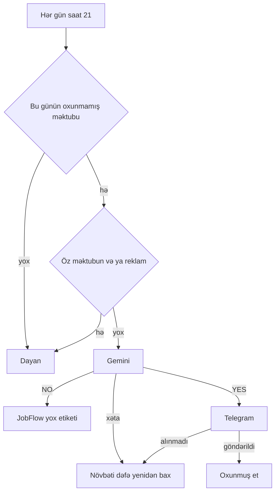

# Job Auto-Flow

Azərbaycan vakansiya saytlarını oxuyur, CV-yə uyğun elanları seçir və Telegrama göndərir. CV və məktub yalnız təsdiqdən sonra hazırlanır. E-poçt da yalnız təsdiqdən sonra gedir. Sayt dörd addımdan ibarətdir: profil, vakansiyalar, CV, göndəriş.

Canlı sayt: [job-auto-flow.onrender.com](https://job-auto-flow.onrender.com/)

## Axın



Skan və CV hazırlığı e-poçt göndərmir. Məktub `DRY_RUN` söndürüldükdə və Göndər basılandan sonra gedir.

## Harada nə işləyir



Render-də Chromium işə düşmür. Skan, CV və göndəriş GitHub Actions-da gedir, çünki brauzer pulsuz Render instansiyasına sığmır.

| İş | Harada | Fayl |
| --- | --- | --- |
| Sayt və Telegram webhook | Render | `app.py` |
| Skan, e-poçtsuz | Actions `job_scanner.yml` | `scan_notify.py` |
| Seçilmiş elan üçün CV, e-poçtsuz | Actions `prepare_cv.yml` | `prepare_cv.py` |
| Təsdiqdən sonra CV və e-poçt | Actions `apply_job.yml` | `apply_one.py` |
| Gələn HR cavabını bota yazmaq | Google Apps Script | `scripts/job_flow_mail_notifier.gs` |

## Saytın addımları



1. **Profil.** CV yüklənir, ad, vəzifə, əlaqə və bacarıqlar formaya düşür. «Yadda saxla» profili saxlayır. «Yenidən oxu» CV-ni modelə yenidən oxutdurur.
2. **Vakansiyalar.** Manual skan yalnız işarələnmiş mənbələri açır. Boş seçim skanı başlatmır. «Uyğunlar», «E-poçtu olanlar» və «Sıfırla» seçimi dəyişir. «Hamısı», «Seçilənlər» və «E-poçt» cədvəli süzür.
3. **CV.** «Seçilənlər üçün CV yarat» və sətirdəki «CV yarat» GitHub-da bir səhifəlik CV və məktub hazırlayır. «PDF-ə bax» hazır faylı açır.
4. **Göndəriş.** «Təsdiqlə və göndər» e-poçtu olanlara məktub göndərir, qalanları Excel-ə yazır. Test rejimi açıq olanda məktub getmir.

Yuxarıdakı Excel düyməsi `/api/export/excel` ünvanından `applications.xlsx` endirir.

## Skan



- Saytdakı «Skanı başlat» yalnız işarələnmiş mənbələri göndərir.
- Telegram `/scan` və `/run`, həmçinin mənbə siyahısı boş olan workflow, `sources.txt`-dəki 12 saytın hamısını açır.
- Eyni skan artıq növbədədirsə, ikincisi açılmır.
- Elan `MIN_MATCH_SCORE` faizindən aşağıdırsa Telegrama düşmür.
- Başlıqda intern, staj, trainee və ya junior olan elanlar kənarda qalır.
- 30 gündən köhnə elan saxlanılmır. Müddət `MAX_VACANCY_AGE_DAYS` ilə dəyişir.
- Eyni vakansiya təkrar bildiriş yaratmır.

Mənbələr: Glorri, HelloJob, SmartJob, Busy.az, eJob, JobSearch, Work.az, Boss.az, HRIN, Azerweb, Azvak, HumanPro.

## CV və göndəriş



Telegram kartındakı **Göndər** `apply_job.yml` işə salır. **Keç** elanı siyahıdan çıxarır. Saytdakı CV düyməsi `prepare_cv.yml` işə salır və məktub göndərmir.

## Profillər və yaddaş

Hər namizədin öz faylı var. Saytda profil seçimi yoxdur: yüklənən CV aktiv namizəd olur, qalanlar arxada qalır.

```text
profiles/profile_Ad_Soyad.json
profiles/cv_Ad_Soyad.pdf
profiles/state_Ad_Soyad.json
profiles/active.txt
```

Bu qovluq Git-ə düşmür. Render diski silinəndə qalmır. Davamlı nüsxə `job-state` budağındakı `state.json.enc` faylıdır. Fayl Fernet ilə şifrələnir. Açmaq üçün hər yerdə eyni `STATE_FERNET_KEY` olmalıdır. Açıq `main` budağında CV və profil yoxdur.

Sayt elanları bu şifrəli fayldan oxuyur və yalnız aktiv namizədin elanlarını göstərir. Skan bitəndə cədvəl özü yenilənmir: səhifəni yeniləmək lazımdır. CV düyməsindən sonra səhifə hazır PDF-i gözləyir.

## Telegram

Bot JobFlow adlanır.

| Əmr və ya düymə | Nə edir |
| --- | --- |
| `/start` | Söhbəti tanıyır |
| `/scan`, `/run` | Bütün mənbələrlə skan açır |
| Göndər | E-poçt varsa CV hazırlayır və məktubu göndərir |
| CV hazırla | E-poçt yoxdursa CV faylını və məktub mətnini söhbətə qoyur |
| Keç | Elanı keçir |

Webhook Render-ə bağlıdır. Lokal proqramı webhook ünvanı boş halda işə salmaq canlı botu özünə götürür.

Skan, CV, göndəriş və ya gündəlik poçt yoxlaması alınmayanda JobFlow-a xəta mətni gəlir.

## Gələn məktublar

`scripts/job_flow_mail_notifier.gs` məktubu qəbul edən Gmail hesabında işləyir. Hər gün saat 21:00 civarında yalnız həmin günün oxunmamış məktublarına baxır. Gemini müsahibə, texniki tapşırıq, qəbul və ya imtina görsə, xülasəni JobFlow-a göndərir.



Skripti [script.google.com](https://script.google.com) layihəsinə yapışdırın. Tokenləri koda yazmayın. Project Settings → Script properties:

| Açar | Mənası |
| --- | --- |
| `TELEGRAM_BOT_TOKEN` | JobFlow bot tokeni |
| `TELEGRAM_CHAT_ID` | Bildiriş gedən söhbət |
| `GEMINI_API_KEY` | Google AI Studio açarı |

Sonra redaktorda bir dəfə `installTrigger` funksiyasını işə salın. Gmail, xarici sorğu və trigger icazəsini təsdiqləyin. Skript məktubu qəbul edən hesabda işləməlidir. `NO` cavabı `JobFlow/yox` etiketi qoyur. Uğurlu bildiriş `JobFlow/gonderildi` etiketi qoyur. Telegram alınmasa etiket yazılmır və növbəti yoxlama təkrar cəhd edir.

## GitHub tokeni

Sayt və Telegram workflow-u Render-dəki `GITHUB_TOKEN` ilə açır. Bu, fine-grained token olmalıdır və yalnız bu repoya aid olmalıdır. Account icazəsi kifayət etmir. Repository permissions:

- Actions: Read and write
- Contents: Read and write

GitHub səhifəsindəki Run workflow düyməsi bu tokenə bağlı deyil. O, hesaba daxil olan istifadəçi ilə işləyir.

## Mühit

Dəyərləri repoya yazmayın. Lokal üçün `.env`, Actions üçün repository secrets, sayt üçün Render Environment.

| Açar | Harada lazımdır |
| --- | --- |
| `LLM_API_KEY`, `LLM_BASE_URL`, `LLM_MODEL_NAME` | Skan və CV |
| `MIN_MATCH_SCORE` | Uyğunluq həddi |
| `MAX_JOBS_PER_SOURCE` | Bir saytdan elan limiti |
| `MAX_VACANCY_AGE_DAYS` | Elanın maksimum yaşı |
| `DRY_RUN` | `true` olanda məktub getmir |
| `SMTP_HOST`, `SMTP_PORT`, `SMTP_EMAIL`, `SMTP_PASSWORD` | Göndəriş |
| `TELEGRAM_BOT_TOKEN`, `TELEGRAM_CHAT_ID` | Bot |
| `STATE_FERNET_KEY` | Şifrəli yaddaş. 44 simvol, dırnaqsız |
| `GITHUB_TOKEN`, `GITHUB_REPOSITORY` | Workflow və state |
| `PROFILE_JSON` | Actions ehtiyat profili |
| `FATHER_NAME` | CV forması |

`STATE_FERNET_KEY` hər yerdə eyni qalmalıdır. Yeni açar köhnə `state.json.enc` faylını oxuya bilmir.

## Lokal işə salma

```bash
python -m venv .venv
.venv/bin/pip install -r requirements.txt
.venv/bin/playwright install chromium
.venv/bin/uvicorn app:app --host 127.0.0.1 --port 8000
```

Planlı skanı `python main.py` ilə işə salmayın: o, uyğun elanı özü e-poçtla göndərə bilər. Skan üçün `scan_notify.py` və ya saytdakı düymə var.

## Repoda olmayanlar

`.env`, `profile.json`, `cv.pdf`, `state.json`, `profiles/`, `applications.xlsx` və `output/` Git-ə düşmür. `information/` qeydləri də commit olunmur.
